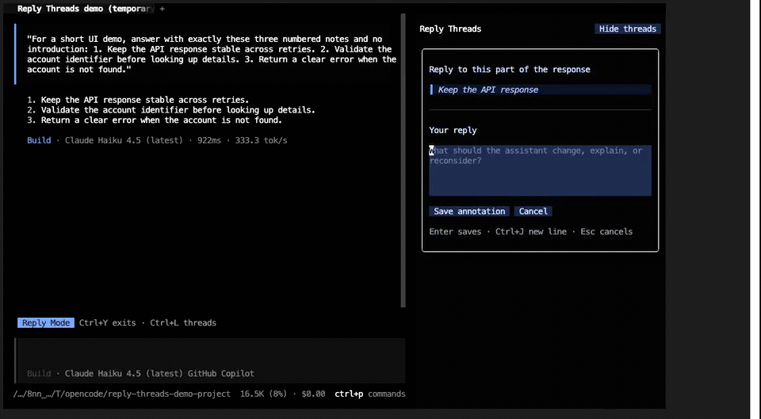
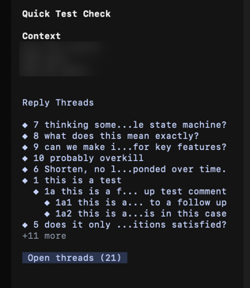
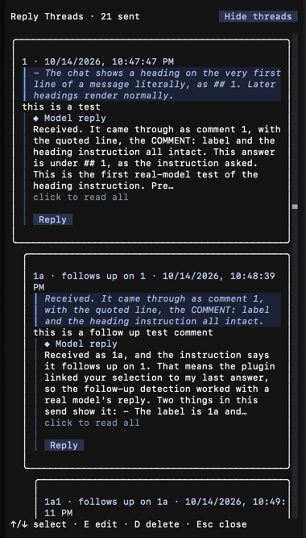

# Reply Threads

OpenCode 2 plugin for a threaded comment experience when replying in chat (like Reddit in your chat). Select some text, reply to it. You can comment on multiple parts before sending it back to the AI!

Your comments and the model's replies are saved in threads so you can track how the model responded over time.

The model doesn't see comments until you send them.



| Thread list in the sidebar | Replies and follow-ups |
| :---: | :---: |
| [](docs/reply-threads-sidebar.png) | [](docs/reply-threads-nested-replies.png) |

Click either screenshot to view it full size.

```text
Turn on Reply Mode
        |
        v
Select text <----------------------+
        |                          |
        v                          |
Write and save a comment           |
        |                          |
        +--- Add another ----------+
        |
        v
Send pending comments together
        |
        v
Read model answers in thread
```

## Requirements

- **`opencode` 2.4.1** (the server part is checked on this version). The plugin was built against `0.0.0-beta-19271`. Other versions have not been tested.
- Node 22.13+ to install dependencies. Tests also require Bun.
- A terminal with mouse support for selecting text.

## Install

### Local development checkout

In your local checkout, install dependencies:

```sh
cd /path/to/reply-threads
npm install
```

Add the checkout's absolute path to both OpenCode configuration files. OpenCode loads the server and TUI plugins separately.

`~/.config/opencode/opencode.json`:

```json
{
  "plugins": ["/absolute/path/to/reply-threads"]
}
```

`~/.config/opencode/cli.json`:

```json
{
  "plugins": ["/absolute/path/to/reply-threads"]
}
```

Keep your existing settings and plugin entries. If your preview build uses `tui.json`, add the path there too.

### Install from a Git repository

Reply Threads has a server part and a TUI part. OpenCode loads them from two different config files, so a Git install takes two steps.

1. **Server part.** This downloads the repository and installs its dependencies. You don't need to run `npm install`.

   ```sh
   opencode plugin add 'github:sunnymui/reply-threads'
   ```

   It adds `github:sunnymui/reply-threads` to the `plugins` list in `~/.config/opencode/opencode.json`.

2. **TUI part.** `plugin add` does not do this. Create or edit `~/.config/opencode/cli.json` and add the same entry. Keep any entries already there.

   ```json
   {
     "plugins": ["github:sunnymui/reply-threads"]
   }
   ```

3. **Restart.** Run `opencode service restart`, quit the TUI with `Ctrl+C`, then start `opencode` again. Open a session and check that the Reply Mode toolbar appears. Without step 2, the toolbar and panel never appear.

The server part loads from a Git install (checked on OpenCode 2.4.1). The toolbar has not been checked after a Git install. Use a local checkout for development.

Git installs fail if `package.json` has a script named `build`, `prepare`, `prepack`, `install`, `preinstall` or `postinstall`. This is an OpenCode bug. Don't add scripts with those names.

The package isn't published to npm. Install it from GitHub.

After changing the plugin, restart the TUI client. The background service can keep running.

## Using it

1. **Turn on Reply Mode:** click **Reply Mode**, or press **Ctrl+Y**.
2. **Select text** with the mouse. The right-hand **Reply Threads panel** opens with the selected text quoted above an input box. OpenCode also copies the selection to your clipboard.
3. **Write your reply** and press **Enter** (or click **Save reply**). Ctrl+J adds a line; Esc or **Cancel** discards it.
4. Repeat for other passages. Saved comments appear above the prompt and under **Pending** in the panel. Click **Discard** on a pending comment to remove it before sending.
5. **Send your comments:** click **Send pending replies**, or press **Enter** again after saving with an empty prompt. The comments move to **Sent** in the panel.
6. Press **Ctrl+Y** again (or click **Reply Mode**) to leave Reply Mode.

The input shows **Saving…** during a save and ignores duplicate submissions. If saving fails, your text stays in the editor so you can retry. Switching sessions closes the unsaved editor.

### Enter to send

Enter sends pending comments when all four conditions hold:

- Reply Mode is on.
- At least one comment is pending.
- The annotation editor is closed.
- The prompt is empty.

If the prompt contains text, Enter submits that text and leaves your comments pending. In the annotation editor, Enter saves the comment. In confirmation dialogs, Enter confirms the action. With Reply Mode off, Enter keeps its normal behavior.

Repeated Enter presses during a send are ignored. The save notification says "Press Enter to send." when these conditions hold.

### Threads of replies

Comments have labels unique to the session: `1`, `2`, `3`. Numbering continues across sends. Follow-ups use `1a`, `1b`; a follow-up to `1a` uses `1a1`. Further levels alternate letters and numbers.

The model is asked to answer under matching headings, such as `## 1a`. The panel shows each answer beneath its comment, with follow-ups indented below it. Conversations with recent sends appear first. Follow-ups within a conversation appear oldest first; comments sent together keep their label order. Click a collapsed answer to read it in full.

To follow up:

- **Click Reply beneath an answer.** This opens the editor with the whole answer quoted and turns on Reply Mode. The quote preserves context if OpenCode later compacts the conversation. Long quotes use more tokens. Reply is hidden while an annotation is open or no answer is available.
- **Select text within an answer in Reply Mode.** The plugin links your comment to that answer when the match is unique. If the text matches several answers, or an answer covers several comments without separate headings, it starts a new top-level thread and tells you why.

If the model skips the requested headings, its whole answer appears under the first comment in the batch. The other comments point to it. Threads stay in their original session; new and forked sessions don't inherit them. Comments sent before labels were introduced have no tracked answers.

### Panel and sidebar

The right-hand panel contains the annotation editor, **Pending** comments, and **Sent** conversations. Each pending comment has a **Discard** button. You can also press **E** to edit or **D** to delete a pending comment. Click inside the panel first to give it keyboard focus. Discard and D both ask for confirmation.

OpenCode's native sidebar also shows a compact thread list:

- Up to 10 sent comments, with follow-ups indented. `◈` means answered; `…` means the model is replying.
- An **Open threads (N)** button and pending count, including when nothing has been sent yet.
- Click a comment to open the panel at that comment. Click **Open threads** to open it from the top. Hover over the button for its description and shortcut.

OpenCode automatically shows its sidebar above 120 columns. In narrower terminals, use **Ctrl+L**, `/threads`, or select text in Reply Mode to open the panel.

### Controls

| Control | What it does |
| --- | --- |
| **Reply Mode** / `Ctrl+Y` | Toggle Reply Mode. Hover for a hint. |
| `Ctrl+L` | Open or close the panel. Disabled while an annotation is open. |
| **Send pending replies** | Send all pending comments without confirmation. |
| **Discard** on a pending comment | Confirm and remove that comment before sending. |
| Enter / Ctrl+J / Esc | Save / new line / cancel in the annotation editor. |
| Enter (prompt empty, Reply Mode on, replies pending) | Send the pending replies. |
| `E` / `D` / `↑` / `↓` in the panel | Edit / delete / select a pending comment. |
| **Cancel** / Esc in the editor | Discard the unsaved input and leave the panel open. |
| Esc outside the editor | Close the panel. |
| **Hide threads** | Close the panel and discard any unsaved input. |

### Commands

Find these commands in the command palette (**Ctrl+P**), or type a slash command in the prompt.

| Command ID | Slash | Purpose |
| --- | --- | --- |
| `reply-threads.comment-mode` | | Toggle Reply Mode (`Ctrl+Y`). |
| `reply-threads.add` | `/thread` | Comment on the current selection in the right-hand editor. |
| `reply-threads.open` | `/threads` | Open the Reply Threads panel. |
| `reply-threads.toggle` | | Open or close the panel (`Ctrl+L`). |
| `reply-threads.send` | `/threads-send` | Send all pending threads. |
| `reply-threads.clear` | `/threads-clear` | Confirm and delete pending threads. Keep sent history. |
| `reply-threads.reconcile` | `/threads-reconcile` | Resolve an interrupted or uncertain send. |

## What gets sent

Comments use this plain-text format:

```text
Reply to each comment under a heading with its label (## 1a); 1a follows up on 1. Then ## Revised, if needed.

1a.
> You do not need to restart the background service.

COMMENT: sounds good

3.
> Exit the current TUI with:
> Ctrl+C

COMMENT: is that true?
```

The instruction requests one heading per comment. It includes the follow-up example only when the batch contains a follow-up. Each quoted line starts with `> `; each comment starts with `COMMENT:` after a blank line.

- **Idle session:** the instruction is sent separately and appears in chat as a grey `◈ Reply Threads · 2 comments` label. The next message contains your quotes and comments. The model receives both.
- **Busy session:** the instruction and comments are queued as one message.
- Tracking IDs are stored in message metadata and add no prompt text.
- The instruction uses about 22 tokens, or 32 with a follow-up example, plus about 7 formatting tokens per comment. Quotes and comment text account for the rest.

## Known limitations

- **Plain-text chat:** OpenCode doesn't render user messages as Markdown. Quotes and comments use text markers instead.
- **Model providers:** idle sends use two messages. This hasn't been verified across providers.
- **Model headings:** separate answers depend on the model following the requested heading format.
- **History loading:** older answers may briefly show as unavailable while the panel loads history, or if the history request fails.
- **Focus:** after saving or cancelling an annotation, click inside the panel before using E, D or arrow shortcuts.
- **Compatibility:** tested with OpenCode `0.0.0-beta-19271` and SDK `0.0.0-beta-19275`.

## Troubleshooting

| Symptom | Check |
| --- | --- |
| No toolbar | Open a session. For a local checkout, check the path in `opencode.json` and `cli.json`, run `npm install`, and restart the TUI. For a Git install, check `opencode plugin list` and restart the TUI. |
| Selecting text does nothing | Turn on Reply Mode, then select text with the mouse. |
| Send does nothing | Check the error notification. Run `/threads-reconcile` if a previous send has an unknown result. |
| Comment saved as "unmatched" | The selected text doesn't match the stored source exactly. You can still send the comment. |
| Saved data is incompatible | The plugin stops loading rather than resetting your data. Keep the saved file for diagnosis; the notification identifies the invalid field or unsupported version. |
