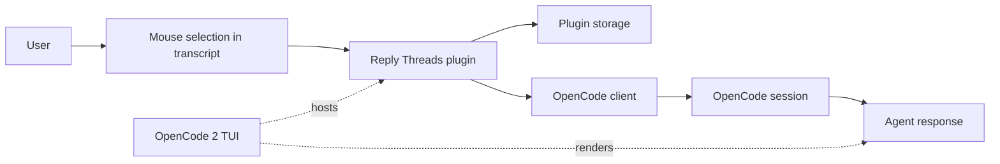
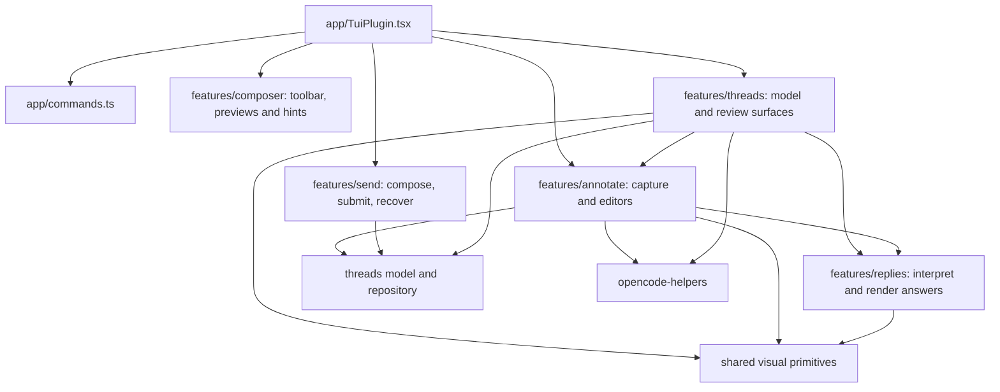
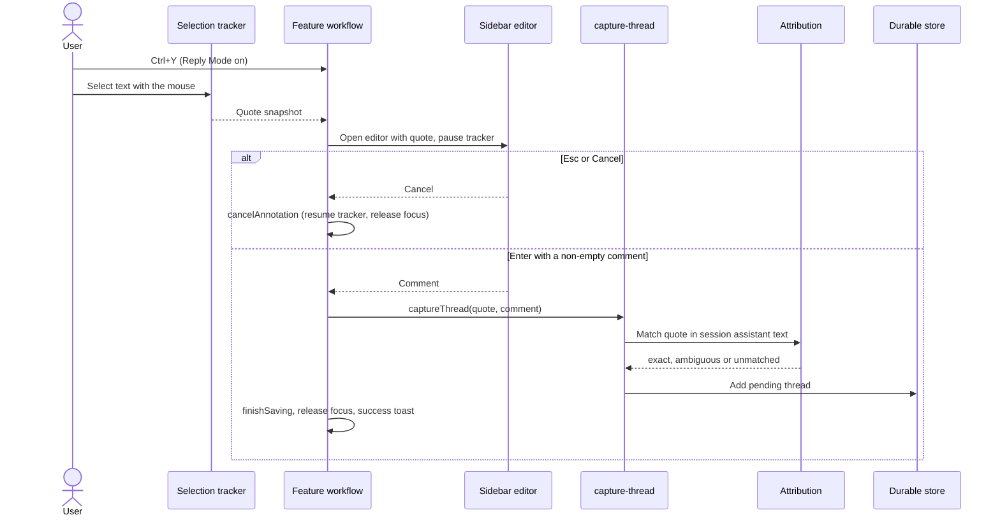
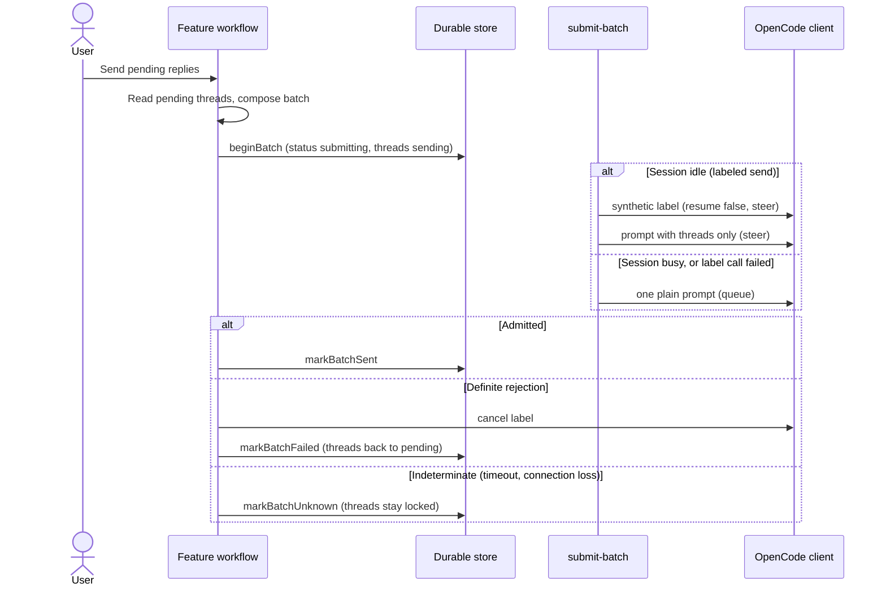
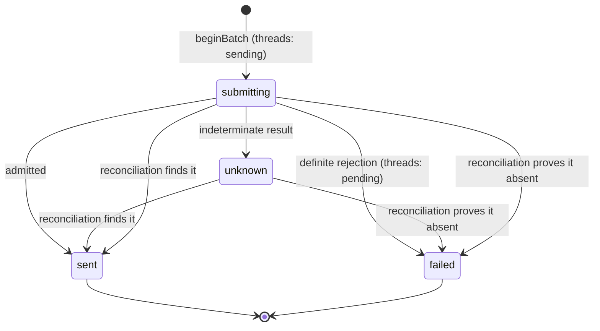
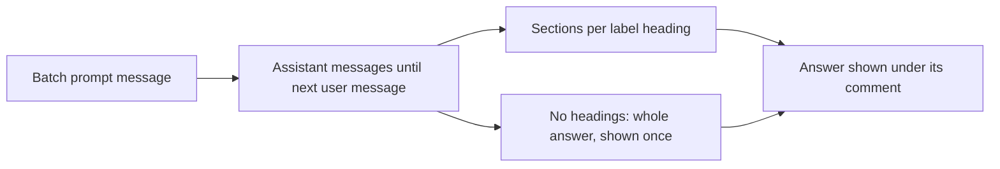

# Reply Threads Architecture

How the plugin is built and why. For install and usage see the [README](../README.md). Host behaviour that shaped the design (and the quirks found) is in [OpenCode 2 compatibility findings](compatibility.md); the original phased plan is in the [implementation plan](implementation-plan.md).

Verified against `opencode 0.0.0-beta-19271` with SDK `@opencode/plugin@0.0.0-beta-19275`.

## System Context

**Summary:** Reply Threads is a client-side TUI plugin inside OpenCode 2. It reads the user's text selection, stores annotations in its own durable storage, and later sends them as ordinary prompts through the client OpenCode hands to the plugin.

**Arrow meaning:** Solid arrows are primary runtime or data flow. Dashed arrows are host-managed relationships.



## Reading Notes

- Thread data belongs to the plugin, never to OpenCode's stored assistant messages. The transcript is not modified.
- The server may be remote; the plugin only uses the host-provided `context.client`.
- There is no inline marker beside the quoted passage: OpenCode has no documented message-decoration slot (see [Inline Indicator Boundary](#inline-indicator-boundary)).
- A successful prompt call means the message was **admitted**, not that the model has answered.

## Component Architecture

**Summary:** `app/TuiPlugin.tsx` composes vertical feature slices. Each slice owns its rules, host calls, components and tests; shared host access lives in `opencode-helpers`, and visual primitives live in `shared`. Threads own the core model and atomic repository transitions.

**Arrow meaning:** Solid arrows show composition or dependencies, including the review panel embedding the annotation editor.




## Source Layout

```text
src/
  app/                         # ServerPlugin, TuiPlugin composition and command wiring
  features/
    composer/                  # ComposerToolbar and its private button
    annotate/                  # capture workflow, attribution, selection and editors
      capture/                 # selection, attribution and thread insertion
      editor/                  # right-hand annotation editor and keyboard handling
    threads/                   # core model, repository, labels, tree, panel and sidebar
      data/                    # thread-types, repository, labels and writer contract
      review/                  # conversation tree shared by panel and sidebar
      panel/                   # full review surface and stable panel ID
      sidebar/                 # compact native-sidebar summary
    replies/                   # answer parsing, parent resolution, ReplyBlock
    send/                      # composition, submission, reconciliation and recovery
      preparation/             # prompt composition and batch intent
      submission/              # host admission and label cancellation
      recovery/                # admission matching and durable recovery
  opencode-helpers/             # shared message-history and focus integration
  shared/ui/                   # reusable visual components and color tokens
  shared/text/                 # pure preview and quote-comparison helpers
```

Read [src/README.md](../src/README.md) and each area's README for the module catalog.
App-facing workflows/actions remain at their feature roots; tests stay beside their modules.
Tests are colocated: `.test.ts` for Node-compatible logic/workflows, `.test.tsx` for
OpenTUI components. `scripts/run-tests.mjs` discovers both suites recursively.


Pure feature rules do not import OpenTUI or the plugin context, so they are tested with plain Node. UI components are tested with OpenTUI's test renderer. Host-dependent behaviour was checked by driving a real TUI in a pseudo-terminal.

## Plugin Wiring

`setup()` in `app/TuiPlugin.tsx` does four things:

1. Opens and validates the durable store through `loadThreadRepository`.
2. Starts the selection tracker (`trackCommentSelection`).
3. Mounts four slots: `app` (registers the commands), `session.composer.top` (toolbar), `session.panel` (the Reply Threads panel) and `sidebar.content` (a compact thread tree in OpenCode's own sidebar).
4. Subscribes to session events and calls `recoverCurrentSession()` so an interrupted send is resolved when its session is active.

Commands are registered from the `app` slot because `keymap.layer` throws inside `setup()` on this runtime (`Keymap.Provider is missing`). Keep that workaround until a newer runtime is verified.

| Command | Slash | Key |
| --- | --- | --- |
| `reply-threads.comment-mode` | | `Ctrl+Y` |
| `reply-threads.add` | `/thread` | |
| `reply-threads.open` | `/threads` | |
| `reply-threads.send` | `/threads-send` | |
| `reply-threads.reconcile` | `/threads-reconcile` | |
| `reply-threads.clear` | `/threads-clear` | |

## Capture Flow

**Summary:** In Reply Mode, selecting transcript text opens the sidebar editor. A thread is stored only after the user saves a non-empty comment.

**Why a snapshot:** the host clears the selection on the next key press or click, so the plugin copies it from the renderer's `selection` event the moment it completes. It also clears the highlight itself shortly after, because the host swallows `Esc` while a selection is highlighted.



`/thread` and `E` to edit use the same right-hand annotation editor as Reply Mode selection.
Editing seeds the existing comment and updates that pending thread in place; Cancel leaves
its stored text unchanged. Enter is bound on a keymap layer targeted at the editor, because
OpenCode's global key handling sees Enter before a focused textarea does.

### Annotation lifecycle

`annotation-state.tsx` owns three states and one session-owned draft:

```text
idle -- openEditor --> editing -- startSaving --> saving
                         ^                         |
                         +----- resumeEditing -----+  failure
                                                   |
idle <-------------------- finishSaving ------------+  success
```

`cancelAnnotation` and session changes close the editor and invalidate outstanding work.
The draft holds its ID, session, quote, initial comment and optional parent/editing-thread ID.
Each save captures that draft once and checks ownership after history loading and inside the
storage mutation. Duplicate submissions are ignored. A late result from a cancelled or
already committed save cannot close a newer draft; failure restores editing without losing
typed input. Reply Mode and textarea focus remain separate from this small state machine.

## Send Flow

**Summary:** A send is recorded durably before any network call, with a stable message ID, so a lost response never causes a blind duplicate.

There is no confirmation step: **Send pending replies** sends immediately.



### Prompt format

One plain-text message (OpenCode does not render user messages as Markdown):

```text
Reply to each comment under a heading with its label (## 1a); 1a follows up on 1. Then ## Revised, if needed.

1a.
> quoted line one
> quoted line two

COMMENT: the user's comment
```

The label is session-unique (see [Threaded replies](#threaded-replies)). The instruction's example uses a real label from the batch, and the "follows up on" sentence appears only when the batch contains a follow-up. The format is pinned by tests, including an overhead budget (about 22 fixed tokens, 32 with a follow-up, plus about 7 per thread; quoted text dominates).

### Labeled send

When the session is **idle**, the instruction line goes in a separate synthetic message whose `description` (`Reply Threads · N comments`) is the only part the chat shows, as a grey line. The user message that follows contains just the threads. Details that matter:

- The label uses `resume: false` so it starts no model turn; both messages use `steer` delivery. `queue` was verified to break this: the label starts its own turn and the prompt is stranded.
- Label ID is `msg_<suffix>a` and prompt ID is `msg_<suffix>b`; the chat orders by message ID, so the label cannot appear after the prompt.
- If the label call fails it is cancelled and the plain message is sent instead.
- When the session is **busy**, `steer` would inject into a running turn, so one queued plain message is sent.
- The reconciliation hash covers the full logical prompt (instruction plus body) in both modes.
- Open risk: the model receives two consecutive user messages. Not verified against every provider.

### Batch state machine



Batches in `submitting` or `unknown` are reconciled automatically when their session is active, or manually with `/threads-reconcile`. Reconciliation looks up the message by its stable ID, then by batch metadata (`replyThreadsBatchID`, `replyThreadsPromptHash`). A label is cancelled when the prompt is definitely rejected or proven absent, never on an indeterminate failure (the prompt may still land and consume it).

## Persistence Model

One durable store, `repository`, holds everything. Mutations go through `updateState`, and validation and mutation happen inside a single storage update so a second send cannot claim threads the first already took. The `revision` counter increments on every change.

```json
{
  "schemaVersion": 1,
  "revision": 7,
  "sessions": {
    "ses_example": {
      "threads": [
        {
          "id": "rt_example",
          "sessionID": "ses_example",
          "label": "1a",
          "parentThreadID": "rt_parent",
          "messageID": "msg_example",
          "contentIndex": 0,
          "quote": { "raw": "Selected text", "normalized": "Selected text" },
          "comment": "Clarify this claim.",
          "anchor": { "confidence": "exact", "start": 120, "end": 142 },
          "status": "sending",
          "batchID": "batch_example",
          "createdAt": "2026-10-05T00:00:00.000Z",
          "updatedAt": "2026-10-05T00:00:00.000Z"
        }
      ],
      "batches": [
        {
          "id": "batch_example",
          "sessionID": "ses_example",
          "threadIDs": ["rt_example"],
          "promptMessageID": "msg_<suffix>b",
          "labelMessageID": "msg_<suffix>a",
          "promptHash": "sha256:example",
          "status": "submitting",
          "createdAt": "2026-10-05T00:01:00.000Z",
          "updatedAt": "2026-10-05T00:01:00.000Z"
        }
      ]
    }
  }
}
```

`label` is the session-unique comment label and `parentThreadID` is the comment whose reply this one follows up on; both are absent on threads saved before threading existed. Thread status is `pending`, `sending`, `sent` or `resolved`. Batch status is `submitting`, `sent`, `failed` or `unknown`. `messageID`, `contentIndex` and the anchor offsets are present only when attribution found a match.

### Invariants

- Thread IDs are unique; every thread belongs to exactly one session.
- Pending and sending threads have no `sentAt`; sent threads have `batchID` and `sentAt`.
- A sending thread belongs to exactly one nonterminal batch.
- A batch records its exact thread IDs, a caller-generated prompt message ID and a hash of the logical prompt.
- The user's raw quote and comment are not modified after creation.
- No prompt is sent unless its `submitting` batch was persisted first.

`thread-storage.ts` validates saved data at load and validates each write before/after
mutation. The validator checks a plain JSON snapshot, not the host proxy's symbol metadata,
while retaining the original live view. Missing legacy revision counters default locally to
zero and persist in the next transaction. Unknown fields remain intact. Unsupported schema
versions or malformed fields stop loading with a notification; they are never replaced by an
empty repository. There is no general migration framework until a schema change requires one.

## Threaded replies

**Summary:** Each comment has a session-unique label that the model answers under, so the model's reply can be tied to one specific comment, and a follow-up selected from that reply links back to it. Nothing about replies is stored except the parent link.

### Labels

Top-level comments are `1`, `2`, `3` and keep counting across sends. A follow-up to `1` is `1a`, `1b`; a follow-up to `1a` is `1a1`, `1a2`, then `1a1a`. Digits and letters alternate so a label always parses one way. Labels are derived from existing threads when a comment is saved (inside the same storage update as the add, so two instances cannot hand out the same one). There is no stored counter. Sent threads are never deleted, so a number is reused only if it belonged to a pending thread that was never sent.

### Finding a send's reply

OpenCode links nothing from an assistant message to the prompt behind it: assistant messages have no parent ID or metadata. The reply to a batch is therefore found by position: the assistant messages after the batch's prompt message, up to the next user or synthetic message. A turn is often many assistant messages (one per tool step), and all of them belong to it. A label message sits before the prompt, so it does not end the turn.

The reply text is split into sections by headings that name a label in the batch (`## 1`, `### Thread 1a`, `**1.**`, `## 1. Title`). Only a heading naming a label that is in this batch starts a section, only its first occurrence counts, headings inside code fences are ignored, and a section ends at the next same-or-higher heading or a horizontal rule (so `## Revised` closes the last one). `## 2 options` or a list item `1.` never match.

Replies are derived on every render from the synchronized message cache and are never stored, so they cannot go stale.



### Linking a follow-up

When a comment is saved, `resolveParent` looks for the selected quote in each sent batch's reply, with Markdown syntax stripped from both sides (attribution is often `unmatched` for formatted text, so linking does not depend on it).

| Quote found in | Result |
| --- | --- |
| Exactly one comment's section | That comment is the parent. |
| One batch's reply without usable sections, and the batch had one comment | That comment is the parent. |
| One batch's reply without usable sections, several comments | Saved as a new top-level thread; the toast says it could not tell which comment. |
| More than one batch's reply, or no reply | Saved as a new top-level thread. |

It never guesses. Failed batches and batches missing from the loaded history are never parents.

A comment's **Reply** button skips this search: the draft records `parentThreadID` explicitly,
and quotes the whole derived answer. This preserves context after compaction. Starting a
reply turns Reply Mode on so Enter-to-send applies; Reply is hidden while an annotation is open.

### Sidebar tree

`buildThreadTree` turns the sent comments into a forest: conversations are newest first, ranked by their latest send at any depth, while follow-ups inside a conversation read oldest first, so a parent always precedes its follow-ups and comments sent together keep label order. A follow-up nests under its parent at any depth (indentation is capped at four levels), and one whose parent is unknown is shown as a root rather than dropped. Each node shows its comment and one of: its section, the whole answer (first comment of a headingless batch), "answered together" (the siblings), "no separate answer", "model is replying", "no reply", "not in the loaded history", or "sent before replies were tracked".

## Message Attribution

Terminal selection returns text, not a durable message range, so attribution is conservative:

1. Keep the raw selection; derive a whitespace- and line-ending-normalized comparison form.
2. Read the full paginated session history (`client.message.list`), falling back to cached messages. Active context alone is not enough after compaction.
3. Consider assistant text content blocks only.
4. One occurrence: record message, content index and offsets as `exact`. Several: `ambiguous`, never bound to the newest. None: `unmatched`, kept as an unanchored thread.

Screen coordinates are never used as identity. Wrapping, Markdown styling and highlighted code can make rendered text differ from source text, hence `unmatched` being common and harmless. Attribution is stored for future use; it does not change what is sent.

## UI Surfaces

| Surface | Host extension | Responsibility |
| --- | --- | --- |
| Commands | `keymap.layer` from the `app` slot | Reply Mode toggle (Ctrl+Y), add, open, toggle panel (Ctrl+L; disabled while an annotation is open), send, reconcile, clear; keys, palette, slash. A second layer binds Enter to send (see below). |
| Toolbar | `session.composer.top` | Reply Mode, Send pending replies (only with pending replies), pending preview, hover hint. It has no button for the panel: that lives in the sidebar section and the panel's own header. |
| OpenCode sidebar | `sidebar.content` | A "Reply Threads" section: the sent threads as a compact tree (one line per comment, marker for answered or replying, up to 10 rows then "+N more") and an Open threads (N) button whose hover shows a two-line description and the Ctrl+L shortcut (two rows are reserved so hovering never shifts the layout; the text is kept under about 36 columns, the real width, or it is truncated in the middle). A row opens the one panel at that comment (its card scrolled to the top, highlighted, reply expanded). The button is always drawn when the section is, including with only pending threads (otherwise a closed panel could not be reopened from here); pending threads themselves are not listed. Visible only while the host's sidebar is (auto above 120 columns, never in subagent sessions, replaced by our panel while it is open); at 120 columns or fewer the panel is reached by selecting text in Reply Mode, `/threads` or the command palette. |
| Reply Threads panel | `session.panel` with `context.ui.panel` | The single panel view: annotation editor, then pending cards (edit, delete), then the sent-thread tree (comments, model replies, follow-ups). Pending and sent are always both shown (labelled "Pending" and "Sent" when both exist); there is no history toggle. A Hide threads button in the panel's header closes it (discarding an unsaved annotation, as Esc does); Esc does the same. |
| Confirm dialog | `context.ui.dialog.confirm` | Clearing pending threads and deleting a pending comment. |
| Toasts | `context.ui.toast.show` | Every validation, save, send and failure outcome. Errors are never silent. |

### Enter to send

A base-mode layer binds `return` at priority 100, enabled only when Reply Mode is on,
the right-hand annotation editor is closed, the session has pending threads, and the focused
renderable has no text. The plugin cannot read the prompt directly, so it checks
`renderer.currentFocusedRenderable.plainText`. When disabled, the key falls through to the
host. Confirmation dialogs run in their own mode and retain Enter.

The saved toast uses the same `enterSends` predicate for its "Press Enter to send." hint,
evaluated 100 ms later to allow prompt focus to return. The toolbar cannot watch prompt text,
so its static hint says `Enter sends (empty prompt)`. The send workflow's in-flight guard
prevents duplicate sends from fast repeated Enter or Enter plus a button click.

Verified in a real TUI: Enter sends after saving; a nonempty prompt submits normally and keeps
pending replies; Reply Mode off prevents sending; Enter in clear confirmation only clears.

### Focus handling

While the annotation editor is open the host gives the right pane input focus and lays a transparent overlay over the session pane; the first click elsewhere is spent returning focus. When an annotation closes, `opencode-helpers/panel-focus.ts` dispatches the host's own `pane.focus.left` command so the next click works. The editor itself never claims host panel focus, because doing so made the host drop the next mouse-down. Trade-off: afterwards focus is on the prompt, so the sidebar's `E`, `D` and arrow shortcuts need a click into the sidebar first. See [compatibility findings](compatibility.md).

## Inline Indicator Boundary

The long-term ideal is an indicator beside the original assistant excerpt. The plugin does not fake it by mutating messages or reaching into the render tree. It would need a host contract such as a message-annotation slot or a user-message renderer hook that can key off metadata. If OpenCode adds one, an adapter can be added without changing the domain model: `messageID`, content index, quote and offsets already provide the anchor.

## Failure Boundaries

| Boundary | Handling |
| --- | --- |
| Empty selection or empty comment | Warn with a toast; no state change. |
| Attribution | Save as ambiguous or unmatched instead of guessing. |
| Editor cancelled | No state change. |
| Durable storage | Surface an error; never claim a thread was saved or start an unrecorded send. |
| Follow-up cannot be pinned | Save as a new top-level thread and say so in the toast; never guess a parent. |
| Label message fails | Cancel it and send the plain message. |
| Definite prompt rejection | Cancel the label, mark the batch failed, restore threads to pending. The check is a regex on the error message; typed error classification is still to do. |
| Indeterminate result | Mark the batch unknown, keep threads locked, reconcile before any retry. |
| Concurrent instances | Validation and mutation share one storage update. Covered by unit tests on a serialized store; a live two-instance test has not been run. |
| Plugin unload | Dispose the selection tracker, the three slots and the session listener. |
| Host API drift | Support is limited to the tested OpenCode version; the smoke test starts a real `opencode` with the plugin. |

## Packaging Boundary

The package exposes server and TUI entry points. It is loaded from a local path or from a Git install (`github:sunnymui/reply-threads`). It is `private` and not published to npm:

```json
{
  "name": "opencode-reply-threads",
  "type": "module",
  "exports": { ".": "./src/app/ServerPlugin.ts", "./tui": "./src/app/TuiPlugin.tsx" }
}
```

The root `index.ts`, `tui.ts` and `tui.tsx` re-exports let the directory itself load as a plugin. The pinned preview SDK has transitive `npm audit` advisories to review before any release.

## Architecture Decisions

### ADR-001: Keep annotations outside the canonical transcript

**Decision:** Store annotations as plugin-owned state and submit them later as a normal user prompt.

**Why:** Mutating assistant messages would corrupt model context, race with streaming updates and depend on unsupported APIs.

### ADR-002: Treat quote matching as fallible

**Decision:** Persist attribution confidence and allow unanchored threads.

**Why:** Terminal selection exposes rendered text, which can differ from source Markdown, and duplicate phrases can appear in several messages.

### ADR-003: Use supported host surfaces only

**Decision:** Use keymap layers, slots, dialogs, storage and `context.client`. No renderer-tree manipulation.

**Why:** These are the documented extension points and survive host layout changes better than tree hacks.

### ADR-004: Send one deterministic plain-text prompt

**Decision:** Batch all pending comments in a stable template of `N.`, a `> ` quote, a blank line and `COMMENT: ...`.

**Why:** User messages are not rendered as Markdown, so layout and an all-caps label are the available emphasis. The template adds almost no tokens (measured with the o200k_base tokenizer), keeps thread boundaries clear for the model, and uses the normal prompt path.

### ADR-005: Persist submission intent before calling OpenCode

**Decision:** Create a batch with a caller-generated `msg_...` prompt ID and move its threads to `sending` before admission. Retries reuse that ID.

**Why:** A timeout or crash can occur after OpenCode accepts the prompt but before the plugin hears back. A persisted intent, metadata, prompt hash and stable ID make that state reconcilable and idempotent.

### ADR-006: Preserve raw and normalized quote forms

**Decision:** Store the exact selected text for display and a separately derived comparison form for attribution.

**Why:** Destructive normalization would alter the user's evidence, while exact byte matching is too brittle for rendered Markdown and terminal whitespace.

### ADR-007: Hidden label message for a tidy chat

**Decision:** When idle, send the instruction line as a synthetic message shown only by its `description`, then the threads as the user message.

**Why:** The chat shows user messages as plain text with no styling hook, but renders a synthetic message as a dim grey line. This labels the batch for the reader at zero token cost while the model still receives the instruction. It is skipped when busy to avoid steering a running turn.

### ADR-008: Snapshot the selection and return focus ourselves

**Decision:** Copy the selection from the renderer event when it completes, and dispatch `pane.focus.left` after an annotation closes.

**Why:** The host clears the selection on the next key or click, and its focus overlay swallows the first click after the sidebar editor. Both were reproduced and traced in a real TUI.

### ADR-009: Hierarchical session-unique labels, with replies derived rather than stored

**Decision:** Label each comment `1`, `1a`, `1a1` (unique per session, parent encoded in the label), ask the model to answer under `## <label>`, and derive each reply from history on demand.

**Why:** Assistant messages carry no link to their prompt, so the model has to identify what it is answering; a label it can write back does that. Encoding the parent in the label also shows the model the lineage, and makes the tree unambiguous. Plain per-batch numbers would have restarted at 1 and collided. Deriving replies means nothing can go stale across edits, reverts or compaction.

## Remaining Work

- Live two-instance concurrency test of the durable store.
- Typed API-error classification instead of a regex on the message.
- Validation and migration of persisted state.
- Try the heading instruction against real models (verified with injected replies only) and check consecutive user messages against real providers, and add a setting to disable the labeled send.
- Reassess the SDK and CLI version pairing and the audit findings before publishing.
- Ask upstream for a user-message renderer hook that can key off metadata.

## ADR-010: Organize by feature instead of technical layer

**Decision:** Replace the top-level domain/adapters/ui split with `features/annotate`,
`features/threads`, `features/replies`, `features/send` and `features/composer`. Threads own the core model;
feature-specific host integration and tests are colocated with their use cases.
`app/TuiPlugin.tsx` composes the features. Package exports `.` and `./tui` point directly to
`app/ServerPlugin.ts` and `app/TuiPlugin.tsx`; the root shims target those same files.

**Why:** A change to sending or annotation should be understandable within one feature,
instead of requiring navigation through several horizontal layers. Truly shared host access
and presentation primitives remain explicit OpenCode-helper/shared dependencies. This changes
source organization, not persisted schemas, prompts, command IDs or delivery behavior.
